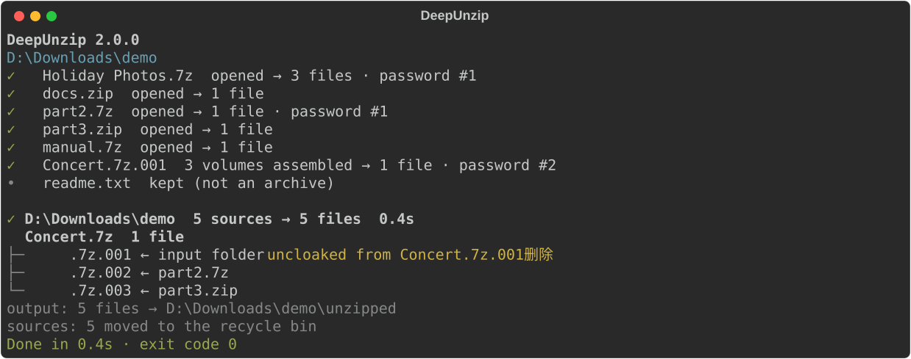

# DeepUnzip

[](https://github.com/rozx/DeepUnzip/releases/latest)
[](https://github.com/rozx/DeepUnzip/releases/latest)
[](https://github.com/rozx/DeepUnzip/releases)
[](https://github.com/rozx/DeepUnzip/releases/latest)
[](https://github.com/rozx/DeepUnzip/actions/workflows/ci.yml)
[](https://github.com/rozx/DeepUnzip/stargazers)
[](LICENSE)


[简体中文](README.md) | **English** | [繁體中文](README.zh-TW.md) | [日本語](README.ja.md) | [한국어](README.ko.md)

DeepUnzip extracts nested, password-protected, multipart and disguised archives in one pass.

## Demo



This is the output of a real run. The folder holds one renamed volume; the other two volumes sit inside two other archives, one of them password-protected. DeepUnzip opens the outer archives, collects the three volumes, extracts them with the second password from the password book, and shows where each volume came from.

## What it solves

If you deal with archives often, you have probably run into these:

- Your downloads folder has piled up dozens of archives: game mods, asset packs, or the string of zip files a Google Takeout export comes in. Point DeepUnzip at the folder and it extracts all of them in one go; archives that extracted fine go to the recycle bin, the ones that didn't stay where they are.
- Everything from one forum, group or author uses the same handful of passwords. Put them in `passwords.txt` and DeepUnzip tries them in order, so you never type them again. Passwords you type during a run are added to the file too.
- Volumes downloaded from a forum, Discord or Telegram, from `.part1.rar` to `.part8.rar`, or a mail attachment split into `.zip`, `.z01` and `.z02` to get under the size limit. As long as they are somewhere under the folder you pass in, even in different subfolders, DeepUnzip finds the whole set before extracting it.
- Archives inside archives, such as a collection where every item was zipped on its own. DeepUnzip keeps opening them, level by level, until nothing is left to open.
- A `.zip` renamed to something like `.zip.txt` to get past a mail or chat attachment filter. DeepUnzip recognizes archives by their content, not their extension.

Doing this by hand means opening archives one by one, trying passwords, moving volumes around, and then working out which originals are safe to delete. DeepUnzip does it with one command, and before it deletes an original it checks that everything extracted from it was handled.

## Features

- Restores mangled file names using rules in `config/cloaked_file_rules.json`, which you can extend. If a file ends up not extracting, its original name is put back.
- Handles `.7z.001`, `.part1.rar`, `.rar` + `.r00`, `.zip` + `.z01` and other multipart formats. Volumes may be spread over different folders or hidden inside other archives.
- Tries the passwords in `passwords.txt` in order. A password you type during a run is used for the archives that follow and saved at the end.
- Opens nested archives level by level until there is nothing new to extract.
- Deletes an original only when everything extracted from it succeeded, and moves it to the recycle bin by default. Anything it cannot extract is kept, and the final summary says why and where.
- Offers `--json` output and clear exit codes for scripts.
- Release packages bundle Python and 7-Zip 26.03, so there is nothing else to install.

## Quick start

1. Download the package for your system from [Releases](https://github.com/rozx/DeepUnzip/releases) (see "Release packages" below).
2. Windows: unpack the `.zip`, then drag the folder or archives onto `deepunzip.exe`.
3. macOS / Linux: unpack the `.tar.gz` and run it in a terminal:

   ```bash
   tar -xzf deepunzip-v2.0.0-macos-arm64.tar.gz
   ./deepunzip ~/Downloads/archives
   ```

Extracted files end up in `unzipped/` inside the folder you passed in.

## Usage

```text
deepunzip [options] <file or folder>...
```

A folder is processed with everything in it. If you pass a single volume, the other volumes of its set in the same folder come along, including renamed ones. Output goes to `unzipped/` in the input folder (or the folder that holds the input file).

| Option | Effect |
| --- | --- |
| `--permanent-delete`, `-pd` | Delete extracted originals instead of moving them to the recycle bin |
| `--json` | Write JSON lines for programs and never ask anything |
| `--version`, `-v` | Show the version |
| `--help` | Show help |

### Passwords

Write one password per line in `passwords.txt`. DeepUnzip reads two password books and merges them:

- `passwords.txt` next to the program (the project root when running from source);
- `passwords.txt` in the input folder (or the folder that holds the input file).

The empty password is always tried first. Lines starting with `#` are comments; write a password that starts with `#` as `\#abc`. The file may be UTF-8, GBK, Big5 or UTF-16.

When no password works, DeepUnzip asks whether to enter a password, skip this archive, or skip all further password questions. A password you enter that opens a file is appended to the `passwords.txt` next to the program. The output never shows a password, only its position, such as "password #2".

### Language

The output is available in English, Simplified Chinese, Traditional Chinese, Japanese and Korean. It follows the system UI language, and systems in any other language get English. Set the `DEEPUNZIP_LANG` environment variable to `en`, `zh`, `zh-TW`, `ja` or `ko` to choose.

### Exit codes

| Code | Meaning |
| --- | --- |
| `0` | Everything was extracted, or there was nothing to do |
| `1` | The run finished, but some items could not be extracted; their originals are kept |
| `2` | Could not run: 7-Zip is missing, none of the given paths exists, or an error occurred |

### Scripting

With `--json`, every line on standard output is a JSON object, and the last one is always `summary`:

```json
{"event": "summary", "schema_version": 1, "status": "partial", "files": 12, "output_dirs": ["D:\\Downloads\\unzipped"], "sources": {"deleted": 3, "kept": 1}, "unresolved": [{"root": 1, "path": "locked.7z", "reason": "password"}], "exit": 1}
```

In `--json` mode DeepUnzip never asks for a password and never waits for Enter at the end. It doesn't ask either when standard input is not a terminal, for example in a scheduled task.

## How it works

1. Scan the input folder and restore mangled file names using the rules.
2. Work in rounds. Each round opens one more level of every archive it can, and the extracted files join the next round.
3. Once the outer archives are open, assemble multipart sets. DeepUnzip first looks for the other volumes in the folder of the first volume, then widens the search to the enclosing folders, up to the input folder. Each candidate combination is screened by file sizes and 7z headers before 7-Zip checks it.
4. A password typed during the run is used for the archives that follow, and multipart sets that failed on a password are retried with it.
5. The run ends when a round makes no progress. Extracted files move to `unzipped/`. Anything extracted from an archive but not usable (an inner archive that won't open, an incomplete set of volumes) goes there as well; files that were already in the input folder stay where they are.
6. An original is deleted only when everything extracted from it succeeded.

If a run is interrupted, the next run puts moved volumes back where they were and asks whether to undo the previous run's renames.

## Release packages

| Platform | File |
| --- | --- |
| Windows x64 | `deepunzip-v2.0.0-windows-x64.zip` |
| macOS Intel | `deepunzip-v2.0.0-macos-x64.tar.gz` |
| macOS Apple Silicon | `deepunzip-v2.0.0-macos-arm64.tar.gz` |
| Linux x64 | `deepunzip-v2.0.0-linux-x64.tar.gz` |
| Linux ARM64 | `deepunzip-v2.0.0-linux-arm64.tar.gz` |

Each package contains the program, the bundled 7-Zip and the license files; the release page also has `SHA256SUMS`. The Linux builds are made on Ubuntu 24.04. The program is not code-signed, and the macOS builds are not notarized. See [7z/README.md](7z/README.md) for where 7-Zip comes from and its checksums.

## FAQ

### Why were some originals not deleted?

Something extracted from them did not succeed, for example a wrong password or a missing volume. The list at the end of the run gives the reason and location of each item. Add the password or the volume and run again.

### Windows says "Windows protected your PC"

The program is not code-signed, so this may appear the first time you run it. Click "More info", then "Run anyway".

### macOS says the developer cannot be verified

The program is not notarized. Run `xattr -d com.apple.quarantine ./deepunzip` in a terminal, then start it again.

### File names are mangled in a way the rules don't cover

Add a rule to `config/cloaked_file_rules.json`; the format is described in the "Renaming/Uncloaking rules" section of [AGENTS.md](AGENTS.md). New rules are welcome as contributions.

### A folder starting with `temp.deepunzip-` showed up

It is the work folder of a run that was interrupted. The next run tells you where it is; once you have checked that nothing in it is needed, you can delete it.

## Development

You need Python 3.11+ and [Poetry](https://python-poetry.org/).

```bash
git clone https://github.com/rozx/DeepUnzip.git
cd DeepUnzip
poetry install

poetry run deepunzip <file or folder>   # run from source; dz works too
poetry run pytest -q                     # run the tests
poetry run build                         # build a standalone program for this platform into dist/
```

Build on the target system and architecture. Architecture, conventions and the release process are described in [AGENTS.md](AGENTS.md) and [CLAUDE.md](CLAUDE.md).

After changing the terminal output, regenerate the screenshot above with `poetry run python -m scripts.generate_screenshots`.

## License and credits

DeepUnzip is released under the MIT license; see [LICENSE](LICENSE). Its extraction engine is [7-Zip](https://www.7-zip.org/), which ships with every package under its own license (GNU LGPL with the unRAR restriction).

Author: [Rozx](https://github.com/rozx)
