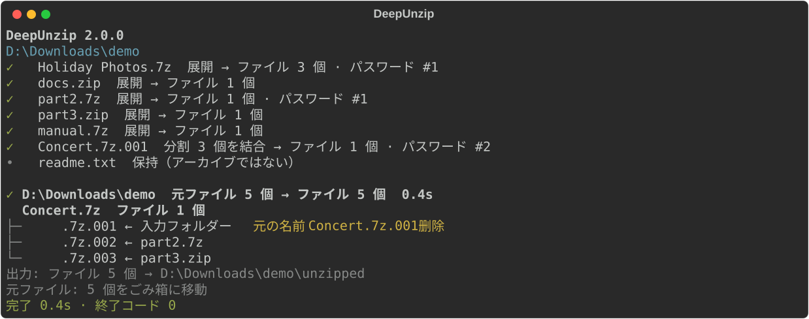

<p align="center">
  
</p>

<h1 align="center">DeepUnzip</h1>

<p align="center">
  <a href="https://github.com/rozx/DeepUnzip/releases/latest"></a>
  <a href="https://github.com/rozx/DeepUnzip/releases/latest"></a>
  <a href="https://github.com/rozx/DeepUnzip/releases"></a>
  <a href="https://github.com/rozx/DeepUnzip/releases/latest"></a>
  <a href="https://github.com/rozx/DeepUnzip/actions/workflows/ci.yml"></a>
  <a href="https://github.com/rozx/DeepUnzip/stargazers"></a>
  <a href="LICENSE"></a>
  
</p>

[简体中文](README.md) | [English](README.en.md) | [繁體中文](README.zh-TW.md) | **日本語** | [한국어](README.ko.md)

DeepUnzip は、入れ子になった、パスワード付きの、分割された、名前を偽装されたアーカイブを一度にまとめて展開します。

## 実行例



上の画像は実際の実行結果です。フォルダーには名前を変えられた分割ボリュームが 1 つあり、残りの 2 つは別々のアーカイブに入っていて、そのうち 1 つにはパスワードがかかっています。DeepUnzip は外側のアーカイブを開いて 3 つのボリュームをそろえ、パスワード帳の 2 番目のパスワードで展開し、最後に各ボリュームがどこから来たかを表示します。

## 何を解決するか

アーカイブをよく扱っていると、次のような場面に出会います。

- ダウンロードフォルダーに、ゲームの Mod、素材集、Google Takeout が分割して書き出した写真の zip など、何十個ものアーカイブがたまっている。フォルダーごと DeepUnzip に渡せば一度に全部展開します。展開できたアーカイブはごみ箱へ移り、展開できなかったものはそのまま残ります。
- 同じフォーラムやグループ、作者のファイルは、いつも同じいくつかのパスワードを使っている。それらを `passwords.txt` に書いておけば順番に試すので、毎回入力する必要はありません。実行中に入力した新しいパスワードも自動で追記されます。
- フォーラムや Discord、Telegram から落とした `.part1.rar` ～ `.part8.rar`、あるいはメールの添付サイズ制限のために `.zip`、`.z01`、`.z02` に分割されたファイル。入力フォルダーの中にあれば、別々のサブフォルダーに散らばっていても、DeepUnzip が自分でそろえてから展開します。
- アーカイブの中にさらにアーカイブがある。たとえば作品集の各作品が個別に圧縮されている場合です。DeepUnzip はアーカイブがなくなるまで 1 段ずつ展開を続けます。
- メールやチャットの添付フィルターを通すために、`.zip` が `.zip.txt` のような名前に変えられている。DeepUnzip は拡張子ではなくファイルの中身でアーカイブを見分けます。

これを手作業でやると、1 つずつ開いてパスワードを試し、ボリュームを移動し、最後にどの元ファイルを消してよいかを自分で判断することになります。DeepUnzip はこれを 1 つのコマンドで行い、元ファイルを削除する前に、そこから展開したものがすべて処理済みであることを確認します。

## 機能

- `config/cloaked_file_rules.json` のルールに従って崩された名前を元に戻します。ルールは自分で追加できます。最終的に展開できなかったファイルは元の名前に戻します。
- `.7z.001`、`.part1.rar`、`.rar` + `.r00`、`.zip` + `.z01` などの分割形式に対応します。ボリュームは別々のフォルダーにあっても、他のアーカイブの中にあってもかまいません。
- `passwords.txt` のパスワードを順番に試します。実行中に入力したパスワードは後続のアーカイブにも使い、終了時に保存します。
- 入れ子のアーカイブを、新しく展開するものがなくなるまで 1 段ずつ開きます。
- 元ファイルは、そこから展開したものがすべて成功した場合にだけ削除し、既定ではごみ箱に移します。展開できなかったものは残し、最後に理由と場所を表示します。
- スクリプト向けに `--json` 出力と明確な終了コードを用意しています。
- リリースパッケージには Python と 7-Zip 26.03 が含まれているので、ほかに何もインストールする必要はありません。

## クイックスタート

1. [Releases](https://github.com/rozx/DeepUnzip/releases) から、お使いのシステム用のパッケージをダウンロードします（下の「リリースパッケージ」を参照）。
2. Windows：`.zip` を展開し、処理したいフォルダーやアーカイブを `deepunzip.exe` にドラッグします。
3. macOS / Linux：`.tar.gz` を展開し、ターミナルで実行します。

   ```bash
   tar -xzf deepunzip-v2.0.0-macos-arm64.tar.gz
   ./deepunzip ~/Downloads/archives
   ```

展開されたファイルは、入力フォルダーの中の `unzipped/` に入ります。

## 使い方

```text
deepunzip [オプション] <ファイルまたはフォルダー>...
```

フォルダーを渡すと、その中のすべてのファイルを処理します。分割ボリュームを 1 つだけ渡した場合は、同じフォルダーにある同じセットの残りのボリュームも、名前を変えられたものを含めて一緒に処理します。出力は入力フォルダー（またはファイルのあるフォルダー）の `unzipped/` に書き出します。

| オプション | 動作 |
| --- | --- |
| `--permanent-delete`, `-pd` | 展開済みの元ファイルをごみ箱に移さず削除する |
| `--json` | プログラム向けの JSON 行を出力し、何も質問しない |
| `--version`, `-v` | バージョンを表示する |
| `--help` | ヘルプを表示する |

### パスワード

`passwords.txt` に 1 行に 1 つずつパスワードを書きます。DeepUnzip は次の 2 か所のパスワード帳を読み込んでまとめます。

- プログラムと同じ場所にある `passwords.txt`（ソースから実行する場合はプロジェクトのルート）
- 入力フォルダー（または入力ファイルのあるフォルダー）にある `passwords.txt`

空のパスワードは必ず最初に試します。`#` で始まる行はコメントです。`#` で始まるパスワードは `\#abc` のように書きます。ファイルの文字コードは UTF-8、GBK、Big5、UTF-16 のいずれでもかまいません。

どのパスワードも合わない場合は、パスワードを入力するか、このアーカイブをスキップするか、以降のパスワードの質問をすべてスキップするかを尋ねます。入力したパスワードでファイルを開けた場合は、プログラムの横にある `passwords.txt` に追記します。出力にパスワードそのものは表示せず、「パスワード #2」のような番号だけを示します。

### 言語

出力は日本語、英語、簡体字中国語、繁体字中国語、韓国語に対応しています。既定ではシステムの表示言語に従い、それ以外の言語のシステムでは英語で表示します。環境変数 `DEEPUNZIP_LANG` に `ja`、`en`、`zh`、`zh-TW`、`ko` のいずれかを設定すると言語を指定できます。

### 終了コード

| 終了コード | 意味 |
| --- | --- |
| `0` | すべて展開できた、または処理するものがなかった |
| `1` | 実行は完了したが展開できない項目があり、その元ファイルは残してある |
| `2` | 実行できなかった：7-Zip が見つからない、指定したパスがどれも存在しない、またはエラーが起きた |

### スクリプトで使う

`--json` を付けると、標準出力の各行が 1 つの JSON オブジェクトになり、最後の行は必ず `summary` です。

```json
{"event": "summary", "schema_version": 1, "status": "partial", "files": 12, "output_dirs": ["D:\\Downloads\\unzipped"], "sources": {"deleted": 3, "kept": 1}, "unresolved": [{"root": 1, "path": "locked.7z", "reason": "password"}], "exit": 1}
```

`--json` モードではパスワードを尋ねず、終了時に Enter を待つこともありません。標準入力が端末でない場合（タスクスケジューラーなど）も質問しません。

## しくみ

1. 入力フォルダーを走査し、ルールに従って崩された名前を元に戻します。
2. ラウンドを重ねて処理します。各ラウンドで開けるアーカイブを 1 段ずつ展開し、取り出したファイルは次のラウンドに回します。
3. 外側のアーカイブがすべて開いたら、分割ボリュームを組み立てます。まず最初のボリュームがあるフォルダーで同じセットのボリュームを探し、そろわなければ外側のフォルダーへ範囲を広げ、最大で入力フォルダーまで探します。各組み合わせはファイルサイズと 7z ヘッダーでふるいにかけてから 7-Zip で確認します。
4. 実行中に入力した新しいパスワードは後続のアーカイブに使い、パスワードで失敗した分割セットもそのパスワードで再試行します。
5. あるラウンドで何も進展がなければ終了します。展開したファイルは `unzipped/` に移します。アーカイブから取り出したものの処理できなかったもの（開けない内側のアーカイブ、そろわない分割ボリューム）もそこに置きます。入力フォルダーにもともとあったファイルはその場に残ります。
6. 元ファイルは、そこから展開したものがすべて成功した場合にだけ削除します。

実行が途中で中断された場合は、次の実行で移動したボリュームを元の場所に戻し、前回の名前変更を元に戻すかどうかを尋ねます。

## リリースパッケージ

| プラットフォーム | ファイル |
| --- | --- |
| Windows x64 | `deepunzip-v2.0.0-windows-x64.zip` |
| macOS Intel | `deepunzip-v2.0.0-macos-x64.tar.gz` |
| macOS Apple Silicon | `deepunzip-v2.0.0-macos-arm64.tar.gz` |
| Linux x64 | `deepunzip-v2.0.0-linux-x64.tar.gz` |
| Linux ARM64 | `deepunzip-v2.0.0-linux-arm64.tar.gz` |

各パッケージにはプログラム、同梱の 7-Zip、ライセンスファイルが含まれ、リリースページには `SHA256SUMS` もあります。Linux 版は Ubuntu 24.04 でビルドしています。プログラムにはコード署名がなく、macOS 版は公証も受けていません。7-Zip の入手元とチェックサムは [7z/README.md](7z/README.md) を参照してください。

## よくある質問

### 一部の元ファイルが削除されないのはなぜですか？

そこから展開したものの中に、パスワードが違う、ボリュームが足りないなどで処理できなかったものがあります。実行の最後に表示される一覧に、各項目の理由と場所が書かれています。パスワードやボリュームを補ってもう一度実行してください。

### Windows に「Windows によって PC が保護されました」と表示される

プログラムにコード署名がないため、初回の実行時にこの表示が出ることがあります。「詳細情報」をクリックし、「実行」をクリックしてください。

### macOS で開発元を検証できないと表示される

プログラムが公証を受けていないためです。ターミナルで `xattr -d com.apple.quarantine ./deepunzip` を実行してから、もう一度起動してください。

### ルールにない形でファイル名が崩されている

`config/cloaked_file_rules.json` にルールを追加してください。書式は [AGENTS.md](AGENTS.md) の「Renaming/Uncloaking rules」の節にあります。新しいルールのコントリビュートも歓迎します。

### `temp.deepunzip-` で始まるフォルダーができている

前回の実行が中断されたときに残った作業フォルダーです。次の実行でその場所を表示します。必要なファイルが残っていないことを確かめたら削除してかまいません。

## 開発

Python 3.11 以降と [Poetry](https://python-poetry.org/) が必要です。

```bash
git clone https://github.com/rozx/DeepUnzip.git
cd DeepUnzip
poetry install

poetry run deepunzip <ファイルまたはフォルダー>   # ソースから実行（dz でも可）
poetry run pytest -q                               # テストを実行
poetry run build                                   # このプラットフォーム用の単体プログラムを dist/ にビルド
```

ビルドは対象のシステムとアーキテクチャ上で行ってください。アーキテクチャ、開発の約束事、リリース手順は [AGENTS.md](AGENTS.md) と [CLAUDE.md](CLAUDE.md) にまとめています。

ターミナル出力を変更したら、`poetry run python -m scripts.generate_screenshots` で上のスクリーンショットを作り直してください。

## ライセンスと謝辞

DeepUnzip は MIT ライセンスで公開しています。[LICENSE](LICENSE) を参照してください。展開エンジンは [7-Zip](https://www.7-zip.org/) で、各パッケージに同梱され、7-Zip 自身のライセンス（GNU LGPL と unRAR の制限）に従います。

作者：[Rozx](https://github.com/rozx)
