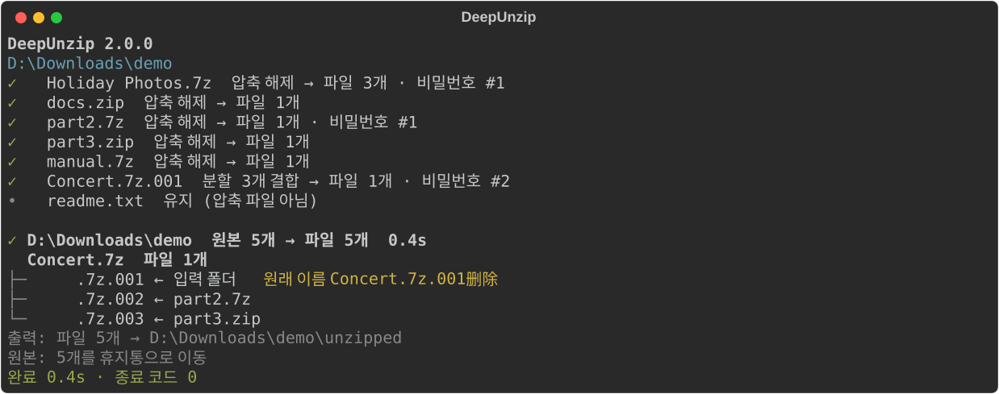

<p align="center">
  
</p>

<h1 align="center">DeepUnzip</h1>

<p align="center">
  <a href="https://github.com/rozx/DeepUnzip/releases/latest"></a>
  <a href="https://github.com/rozx/DeepUnzip/releases/latest"></a>
  <a href="https://github.com/rozx/DeepUnzip/releases"></a>
  <a href="https://github.com/rozx/DeepUnzip/releases/latest"></a>
  <a href="https://github.com/rozx/DeepUnzip/actions/workflows/ci.yml"></a>
  <a href="https://github.com/rozx/DeepUnzip/stargazers"></a>
  <a href="LICENSE"></a>
  
</p>

[简体中文](README.md) | [English](README.en.md) | [繁體中文](README.zh-TW.md) | [日本語](README.ja.md) | **한국어**

DeepUnzip은 중첩되고, 암호가 걸리고, 분할되고, 이름이 위장된 압축 파일을 한 번에 풉니다.

## 실행 화면



위 그림은 실제 실행 결과입니다. 폴더에는 이름이 바뀐 분할 볼륨 하나가 있고, 나머지 두 볼륨은 각각 다른 압축 파일 안에 들어 있으며 그중 하나에는 비밀번호가 걸려 있습니다. DeepUnzip은 바깥 압축 파일을 열어 세 볼륨을 모으고, 비밀번호 목록의 두 번째 비밀번호로 푼 다음, 각 볼륨이 어디에서 왔는지 보여 줍니다.

## 무엇을 해결하나

압축 파일을 자주 다루다 보면 이런 일을 겪게 됩니다.

- 다운로드 폴더에 게임 모드, 에셋 팩, Google Takeout이 여러 개로 나눠 내보낸 사진 zip 같은 압축 파일이 수십 개 쌓여 있습니다. 폴더째 DeepUnzip에 넘기면 한 번에 모두 풉니다. 푼 압축 파일은 휴지통으로 옮기고, 풀지 못한 파일은 그대로 둡니다.
- 같은 포럼이나 그룹, 작성자가 올린 파일은 늘 같은 비밀번호 몇 개를 씁니다. 이 비밀번호를 `passwords.txt`에 적어 두면 순서대로 시도하므로 매번 입력할 필요가 없습니다. 실행 중에 새로 입력한 비밀번호도 자동으로 추가됩니다.
- 포럼, Discord, Telegram에서 받은 `.part1.rar`부터 `.part8.rar`까지의 파일, 또는 메일 첨부 용량 제한 때문에 `.zip`, `.z01`, `.z02`로 나뉜 파일. 입력한 폴더 안에만 있으면 서로 다른 하위 폴더에 흩어져 있어도 DeepUnzip이 알아서 모은 다음 풉니다.
- 압축 파일 안에 또 압축 파일이 있는 경우. 예를 들어 모음집의 작품마다 따로 압축되어 있을 때입니다. DeepUnzip은 더 풀 압축 파일이 없을 때까지 한 단계씩 계속 풉니다.
- 메일이나 메신저의 첨부 파일 필터를 통과하려고 `.zip`의 이름을 `.zip.txt`처럼 바꾼 경우. DeepUnzip은 확장자가 아니라 파일 내용으로 압축 파일을 알아봅니다.

이런 일을 손으로 처리하려면 하나씩 열어 비밀번호를 시도하고, 볼륨을 옮기고, 마지막으로 어떤 원본을 지워도 되는지 직접 판단해야 합니다. DeepUnzip은 이 과정을 명령 하나로 처리하며, 원본을 지우기 전에 거기서 풀어낸 내용이 모두 처리되었는지 확인합니다.

## 기능

- `config/cloaked_file_rules.json`의 규칙에 따라 망가진 파일 이름을 되돌립니다. 규칙은 직접 추가할 수 있습니다. 끝내 풀지 못한 파일은 원래 이름으로 되돌립니다.
- `.7z.001`, `.part1.rar`, `.rar` + `.r00`, `.zip` + `.z01` 등의 분할 형식을 지원합니다. 볼륨이 여러 폴더에 흩어져 있거나 다른 압축 파일 안에 들어 있어도 됩니다.
- `passwords.txt`의 비밀번호를 순서대로 시도합니다. 실행 중에 입력한 비밀번호는 이후 압축 파일에도 쓰고, 끝날 때 저장합니다.
- 더 풀 것이 없을 때까지 중첩된 압축 파일을 한 단계씩 엽니다.
- 원본 파일은 거기서 풀어낸 내용이 모두 성공했을 때만 지우며, 기본적으로 휴지통으로 옮깁니다. 풀지 못한 것은 남겨 두고, 마지막에 이유와 위치를 알려 줍니다.
- 스크립트용으로 `--json` 출력과 명확한 종료 코드를 제공합니다.
- 릴리스 패키지에 Python과 7-Zip 26.03이 들어 있어 따로 설치할 것이 없습니다.

## 빠른 시작

1. [Releases](https://github.com/rozx/DeepUnzip/releases)에서 사용 중인 시스템용 패키지를 내려받습니다(아래 "릴리스 패키지" 참고).
2. Windows: `.zip`을 풀고, 처리할 폴더나 압축 파일을 `deepunzip.exe` 위로 끌어다 놓습니다.
3. macOS / Linux: `.tar.gz`를 풀고 터미널에서 실행합니다.

   ```bash
   tar -xzf deepunzip-v2.0.0-macos-arm64.tar.gz
   ./deepunzip ~/Downloads/archives
   ```

풀린 파일은 입력한 폴더 안의 `unzipped/`에 들어갑니다.

## 사용법

```text
deepunzip [옵션] <파일 또는 폴더>...
```

폴더를 넘기면 그 안의 모든 파일을 처리합니다. 분할 볼륨 하나만 넘기면 같은 폴더에 있는 같은 세트의 나머지 볼륨도, 이름이 바뀐 것까지 함께 처리합니다. 출력은 입력 폴더(또는 입력 파일이 있는 폴더)의 `unzipped/`에 씁니다.

| 옵션 | 동작 |
| --- | --- |
| `--permanent-delete`, `-pd` | 풀어낸 원본 파일을 휴지통으로 옮기지 않고 삭제 |
| `--json` | 프로그램용 JSON 줄을 출력하고 아무것도 묻지 않음 |
| `--version`, `-v` | 버전 표시 |
| `--help` | 도움말 표시 |

### 비밀번호

`passwords.txt`에 한 줄에 하나씩 비밀번호를 적습니다. DeepUnzip은 다음 두 곳의 비밀번호 목록을 읽어 합칩니다.

- 프로그램과 같은 위치의 `passwords.txt`(소스에서 실행할 때는 프로젝트 루트)
- 입력 폴더(또는 입력 파일이 있는 폴더)의 `passwords.txt`

빈 비밀번호를 항상 가장 먼저 시도합니다. `#`으로 시작하는 줄은 주석이며, `#`으로 시작하는 비밀번호는 `\#abc`처럼 씁니다. 파일 인코딩은 UTF-8, GBK, Big5, UTF-16 중 무엇이든 됩니다.

맞는 비밀번호가 없으면 비밀번호를 입력할지, 이 압축 파일을 건너뛸지, 이후의 비밀번호 질문을 모두 건너뛸지 묻습니다. 입력한 비밀번호로 파일을 열었다면 프로그램 옆의 `passwords.txt`에 추가합니다. 출력에는 비밀번호 자체가 나오지 않고 "비밀번호 #2" 같은 번호만 표시합니다.

### 언어

출력은 한국어, 영어, 중국어 간체, 중국어 번체, 일본어를 지원합니다. 기본적으로 시스템 표시 언어를 따르며, 그 밖의 언어를 쓰는 시스템에서는 영어로 표시합니다. 환경 변수 `DEEPUNZIP_LANG`를 `ko`, `en`, `zh`, `zh-TW`, `ja` 중 하나로 설정하면 언어를 지정할 수 있습니다.

### 종료 코드

| 종료 코드 | 의미 |
| --- | --- |
| `0` | 모두 풀었거나 처리할 것이 없음 |
| `1` | 실행은 끝났지만 풀지 못한 항목이 있으며, 해당 원본 파일은 남겨 둠 |
| `2` | 실행할 수 없음: 7-Zip이 없거나, 지정한 경로가 모두 없거나, 오류가 발생함 |

### 스크립트에서 사용하기

`--json`을 붙이면 표준 출력의 각 줄이 JSON 객체 하나가 되며, 마지막 줄은 항상 `summary`입니다.

```json
{"event": "summary", "schema_version": 1, "status": "partial", "files": 12, "output_dirs": ["D:\\Downloads\\unzipped"], "sources": {"deleted": 3, "kept": 1}, "unresolved": [{"root": 1, "path": "locked.7z", "reason": "password"}], "exit": 1}
```

`--json` 모드에서는 비밀번호를 묻지 않고, 끝날 때 Enter를 기다리지도 않습니다. 표준 입력이 터미널이 아닐 때(예: 작업 스케줄러)도 묻지 않습니다.

## 동작 방식

1. 입력 폴더를 살펴보고 규칙에 따라 망가진 파일 이름을 되돌립니다.
2. 라운드 단위로 처리합니다. 라운드마다 열 수 있는 압축 파일을 한 단계씩 풀고, 꺼낸 파일은 다음 라운드로 넘깁니다.
3. 바깥 압축 파일이 모두 열리면 분할 볼륨을 조립합니다. 먼저 첫 번째 볼륨이 있는 폴더에서 같은 세트의 볼륨을 찾고, 다 모이지 않으면 바깥 폴더로 범위를 넓혀 최대 입력 폴더까지 찾습니다. 각 조합은 파일 크기와 7z 헤더로 먼저 걸러 낸 뒤 7-Zip으로 확인합니다.
4. 실행 중에 입력한 새 비밀번호는 이후 압축 파일에 쓰이고, 비밀번호 때문에 실패했던 분할 세트도 그 비밀번호로 다시 시도합니다.
5. 어떤 라운드에서 아무 진전이 없으면 끝납니다. 풀어낸 파일은 `unzipped/`로 옮깁니다. 압축 파일에서 꺼냈지만 처리하지 못한 것(열리지 않는 안쪽 압축 파일, 다 모이지 않은 분할 볼륨)도 그곳에 둡니다. 입력 폴더에 원래 있던 파일은 그 자리에 남습니다.
6. 원본 파일은 거기서 풀어낸 내용이 모두 성공했을 때만 지웁니다.

실행이 도중에 중단되면 다음 실행에서 옮겨 둔 볼륨을 원래 자리로 되돌리고, 지난번의 이름 변경을 되돌릴지 묻습니다.

## 릴리스 패키지

| 플랫폼 | 파일 |
| --- | --- |
| Windows x64 | `deepunzip-v2.0.0-windows-x64.zip` |
| macOS Intel | `deepunzip-v2.0.0-macos-x64.tar.gz` |
| macOS Apple Silicon | `deepunzip-v2.0.0-macos-arm64.tar.gz` |
| Linux x64 | `deepunzip-v2.0.0-linux-x64.tar.gz` |
| Linux ARM64 | `deepunzip-v2.0.0-linux-arm64.tar.gz` |

각 패키지에는 프로그램, 함께 들어 있는 7-Zip, 라이선스 파일이 있으며, 릴리스 페이지에는 `SHA256SUMS`도 있습니다. Linux 버전은 Ubuntu 24.04에서 빌드합니다. 프로그램에는 코드 서명이 없고, macOS 버전은 공증도 받지 않았습니다. 7-Zip의 출처와 체크섬은 [7z/README.md](7z/README.md)를 참고하세요.

## 자주 묻는 질문

### 일부 원본 파일이 지워지지 않은 이유는?

거기서 풀어낸 것 중에 비밀번호가 틀리거나 볼륨이 모자라는 등 처리하지 못한 것이 있기 때문입니다. 실행이 끝날 때 나오는 목록에 항목마다 이유와 위치가 적혀 있습니다. 비밀번호나 볼륨을 채운 뒤 다시 실행하세요.

### Windows에 "Windows의 PC 보호" 창이 뜹니다

프로그램에 코드 서명이 없어서 처음 실행할 때 이 창이 뜰 수 있습니다. "추가 정보"를 누른 다음 "실행"을 누르세요.

### macOS에서 개발자를 확인할 수 없다고 나옵니다

프로그램이 공증을 받지 않았기 때문입니다. 터미널에서 `xattr -d com.apple.quarantine ./deepunzip`을 실행한 뒤 다시 실행하세요.

### 규칙에 없는 방식으로 파일 이름이 망가져 있습니다

`config/cloaked_file_rules.json`에 규칙을 추가하세요. 형식은 [AGENTS.md](AGENTS.md)의 "Renaming/Uncloaking rules" 절에 있습니다. 새 규칙 기여도 환영합니다.

### `temp.deepunzip-`로 시작하는 폴더가 생겼습니다

이전 실행이 중단되면서 남은 작업 폴더입니다. 다음 실행 때 그 위치를 알려 줍니다. 안에 필요한 파일이 없는지 확인한 뒤 지워도 됩니다.

## 개발

Python 3.11 이상과 [Poetry](https://python-poetry.org/)가 필요합니다.

```bash
git clone https://github.com/rozx/DeepUnzip.git
cd DeepUnzip
poetry install

poetry run deepunzip <파일 또는 폴더>   # 소스에서 실행(dz도 가능)
poetry run pytest -q                     # 테스트 실행
poetry run build                         # 현재 플랫폼용 단독 실행 프로그램을 dist/에 빌드
```

빌드는 대상 시스템과 아키텍처에서 해야 합니다. 구조, 개발 규칙, 릴리스 절차는 [AGENTS.md](AGENTS.md)와 [CLAUDE.md](CLAUDE.md)에 정리되어 있습니다.

터미널 출력을 바꿨다면 `poetry run python -m scripts.generate_screenshots`로 위의 스크린샷을 다시 만드세요.

## 라이선스와 감사의 말

DeepUnzip은 MIT 라이선스로 공개합니다. [LICENSE](LICENSE)를 참고하세요. 압축 해제 엔진은 [7-Zip](https://www.7-zip.org/)으로, 모든 패키지에 함께 들어 있으며 7-Zip 자체의 라이선스(GNU LGPL과 unRAR 제한)를 따릅니다.

만든 사람: [Rozx](https://github.com/rozx)
