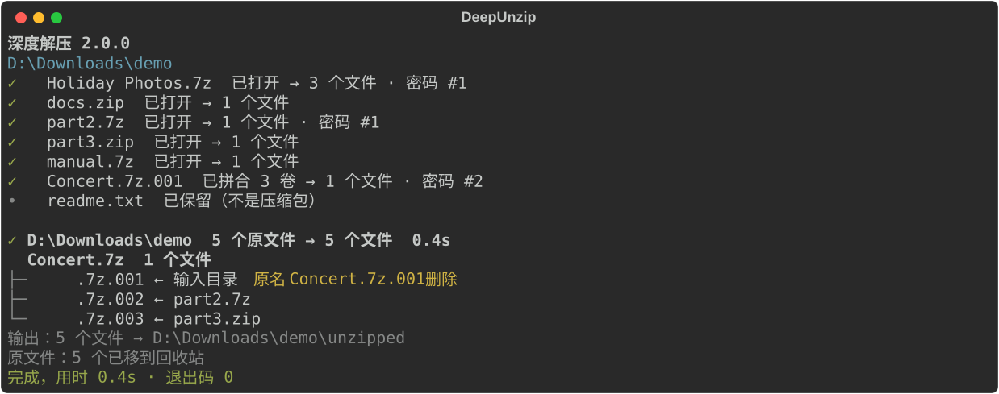

# 深度解压 DeepUnzip

[](https://github.com/rozx/DeepUnzip/releases/latest)
[](https://github.com/rozx/DeepUnzip/releases/latest)
[](https://github.com/rozx/DeepUnzip/releases)
[](https://github.com/rozx/DeepUnzip/releases/latest)
[](https://github.com/rozx/DeepUnzip/actions/workflows/ci.yml)
[](https://github.com/rozx/DeepUnzip/stargazers)
[](LICENSE)


**简体中文** | [English](README.en.md) | [繁體中文](README.zh-TW.md) | [日本語](README.ja.md) | [한국어](README.ko.md)

深度解压：一次解开套娃、加密、分卷和伪装的压缩包。

## 运行效果



上图是一次真实运行的结果：文件夹里有一个改了名的分卷，另外两个分卷分别装在两个压缩包里，其中一个还加了密码。深度解压先打开外层压缩包，找齐三个分卷，用密码本里的第二个密码解开，最后列出每个分卷的来历。

## 解决什么问题

压缩包用得多了，总会遇到下面这些情况：

- 下载目录里攒了几十个压缩包，比如游戏 Mod、素材包，或者 Google Takeout 拆成的一串照片导出包。把整个文件夹交给深度解压，一次全部解开；解开了的压缩包移到回收站，解不开的原样留下。
- 同一个论坛、群组或作者发的资源，密码来来回回就那几个。把它们写进 `passwords.txt`，程序会按顺序逐个尝试，不用每次手动输入；运行中新输入的密码也会自动记进去。
- 从论坛、Discord 或 Telegram 下载的 `.part1.rar` 到 `.part8.rar`，或者因为邮件附件大小限制被拆成 `.zip`、`.z01`、`.z02` 的文件。只要都在同一个输入文件夹里，哪怕分散在不同的子文件夹，程序也会自己找齐再解压。
- 压缩包里还有压缩包，比如合集里的每个作品又单独打了包。程序会一层层解开，直到没有压缩包为止。
- 为了通过邮件或聊天软件的附件过滤，`.zip` 被改成了 `.zip.txt` 这样的名字。程序按文件内容而不是扩展名识别压缩包。
- 网盘上的资源为了躲避审查，文件名被故意改坏，`movie.7z.001` 变成 `movie.7z.001删除`，分卷还被拆开，各自装进别的压缩包。程序会还原文件名，再从各个压缩包里把分卷找齐。

手动处理这些情况，要一个个打开、试密码、挪分卷，最后还得自己判断哪些原文件可以删。深度解压把这些合成一条命令，删除原文件前会确认它解出的东西都处理好了。

## 功能

- 按规则还原被改坏的文件名，规则写在 `config/cloaked_file_rules.json`，可以自己添加。如果文件最后没能解开，原文件名会被改回来。
- 支持 `.7z.001`、`.part1.rar`、`.rar` + `.r00`、`.zip` + `.z01` 等分卷格式。分卷可以散落在不同文件夹，也可以藏在别的压缩包里。
- 从 `passwords.txt` 里按顺序试密码。运行中手动输入的密码会用于后面的压缩包，并在结束时保存下来。
- 逐层解开嵌套的压缩包，直到没有新东西可解。
- 原文件只有在解出的内容全部处理成功后才会删除，默认移到回收站。解不开的东西会保留，并在结尾写明原因和位置。
- 提供 `--json` 输出和明确的退出码，方便写进脚本。
- 发布包自带 Python 和 7-Zip 26.03，下载后直接运行。

## 快速开始

1. 在 [Releases](https://github.com/rozx/DeepUnzip/releases) 下载对应系统的发布包（见下方「发布包」）。
2. Windows：解开 `.zip`，把要处理的文件夹或压缩包拖到 `deepunzip.exe` 上。
3. macOS / Linux：解开 `.tar.gz`，在终端运行：

   ```bash
   tar -xzf deepunzip-v2.0.0-macos-arm64.tar.gz
   ./deepunzip ~/Downloads/资源
   ```

解出的文件在输入文件夹里的 `unzipped/` 下。

## 用法

```text
deepunzip [选项] <文件或文件夹>...
```

传入文件夹时处理其中的所有文件；只传入一个分卷时，同一文件夹里同组的其余分卷会自动带上，包括名字被改过的。输出写到输入文件夹（或文件所在文件夹）下的 `unzipped/`。

| 选项 | 作用 |
| --- | --- |
| `--permanent-delete`, `-pd` | 直接删除已解开的原文件，不移到回收站 |
| `--json` | 输出供程序读取的 JSON 行，不询问任何问题 |
| `--version`, `-v` | 显示版本 |
| `--help` | 显示帮助 |

### 密码

在 `passwords.txt` 里每行写一个密码。程序会读取两个位置的密码本并合并：

- 程序旁边的 `passwords.txt`（从源码运行时是项目根目录）；
- 输入文件夹（或输入文件所在文件夹）里的 `passwords.txt`。

空密码总是最先尝试。以 `#` 开头的行是注释，以 `#` 开头的密码写成 `\#abc`。文件可以是 UTF-8、GBK、Big5 或 UTF-16 编码。

所有密码都不对时，程序会询问：输入密码、跳过这个压缩包，或者跳过之后所有的密码询问。输入的密码如果解开了文件，会追加到程序旁边的 `passwords.txt`。输出里不会出现密码本身，只会写「密码 #2」这样的序号。

### 语言

输出支持简体中文、繁体中文、英文、日文和韩文，默认跟随系统界面语言，其他语言的系统输出英文。设置环境变量 `DEEPUNZIP_LANG` 可以指定语言，可选值为 `zh`、`zh-TW`、`en`、`ja`、`ko`。

### 退出码

| 退出码 | 含义 |
| --- | --- |
| `0` | 全部解开，或者没有需要处理的东西 |
| `1` | 运行完成，但有解不开的项目，对应的原文件已保留 |
| `2` | 无法运行：找不到 7-Zip、给出的路径都不存在，或程序出错 |

### 在脚本里使用

加上 `--json` 后，标准输出每行是一个 JSON 对象，最后一行总是 `summary`：

```json
{"event": "summary", "schema_version": 1, "status": "partial", "files": 12, "output_dirs": ["D:\\Downloads\\unzipped"], "sources": {"deleted": 3, "kept": 1}, "unresolved": [{"root": 1, "path": "locked.7z", "reason": "password"}], "exit": 1}
```

`--json` 模式下不会询问密码，也不会在结束时等待回车。标准输入不是终端时（例如计划任务）同样不会询问。

## 工作原理

1. 扫描输入文件夹，按规则还原被改坏的文件名。
2. 一轮一轮地处理。每轮把能打开的压缩包解开一层，解出来的文件进入下一轮。
3. 外层都解开以后，开始拼分卷。程序先在主卷所在的文件夹里找同组的分卷，找不齐再往外层文件夹扩大范围，最远到输入文件夹。每种组合先用文件大小和 7z 文件头筛一遍，再交给 7-Zip 验证。
4. 运行中输入的新密码会用于后面的压缩包，之前因为密码失败的分卷组也会用它再试一次。
5. 某一轮没有任何进展时结束。解出的文件移到 `unzipped/`。从压缩包里解出、但处理不了的东西（打不开的内层压缩包、凑不齐的分卷）也放到那里；输入文件夹里原有的文件留在原处。
6. 一个原文件只有在它解出的所有内容都处理成功后才会被删除。

运行中途被打断时，下次运行会把挪走的分卷放回原处，并询问是否撤销上次的改名。

## 发布包

| 平台 | 文件 |
| --- | --- |
| Windows x64 | `deepunzip-v2.0.0-windows-x64.zip` |
| macOS Intel | `deepunzip-v2.0.0-macos-x64.tar.gz` |
| macOS Apple Silicon | `deepunzip-v2.0.0-macos-arm64.tar.gz` |
| Linux x64 | `deepunzip-v2.0.0-linux-x64.tar.gz` |
| Linux ARM64 | `deepunzip-v2.0.0-linux-arm64.tar.gz` |

每个包含有程序、自带的 7-Zip 和许可证文件，Release 页面另有 `SHA256SUMS`。Linux 版在 Ubuntu 24.04 上构建。程序没有做代码签名，macOS 也没有公证。7-Zip 的来源和校验值见 [7z/README.md](7z/README.md)。

## 常见问题

### 为什么有些原文件没被删除？

它解出的内容里有东西没处理成功，比如密码不对或分卷不全。运行结束时的列表会写明每一项的原因和位置。补上密码或分卷后再运行一次即可。

### Windows 提示「Windows 已保护你的电脑」

程序没有代码签名，第一次运行时可能出现这个提示。点「更多信息」，再点「仍要运行」。

### macOS 提示无法验证开发者

程序没有经过公证。在终端执行 `xattr -d com.apple.quarantine ./deepunzip` 后再运行。

### 文件名被改成了规则里没有的样子

在 `config/cloaked_file_rules.json` 里加一条规则，格式见 [AGENTS.md](AGENTS.md) 的「Renaming/Uncloaking rules」一节。欢迎把新规则提交回来。

### 文件夹里出现了 `temp.deepunzip-` 开头的文件夹

这是上次运行中断后留下的工作文件夹。下次运行时会提示它的位置，确认里面没有需要的文件后可以删除。

## 开发

需要 Python 3.11+ 和 [Poetry](https://python-poetry.org/)。

```bash
git clone https://github.com/rozx/DeepUnzip.git
cd DeepUnzip
poetry install

poetry run deepunzip <文件或文件夹>   # 从源码运行，也可以用 dz
poetry run pytest -q                   # 运行测试
poetry run build                       # 构建当前平台的独立程序到 dist/
```

构建要在目标系统和架构上进行。架构、开发约定和发布流程见 [AGENTS.md](AGENTS.md) 和 [CLAUDE.md](CLAUDE.md)。

修改终端输出后，用 `poetry run python -m scripts.generate_screenshots` 重新生成上面的截图。

## 许可证与致谢

深度解压以 MIT 许可证发布，见 [LICENSE](LICENSE)。解压引擎是 [7-Zip](https://www.7-zip.org/)，随每个发布包附带，遵循它自己的许可证（GNU LGPL 和 unRAR 限制）。

作者：[Rozx](https://github.com/rozx)
