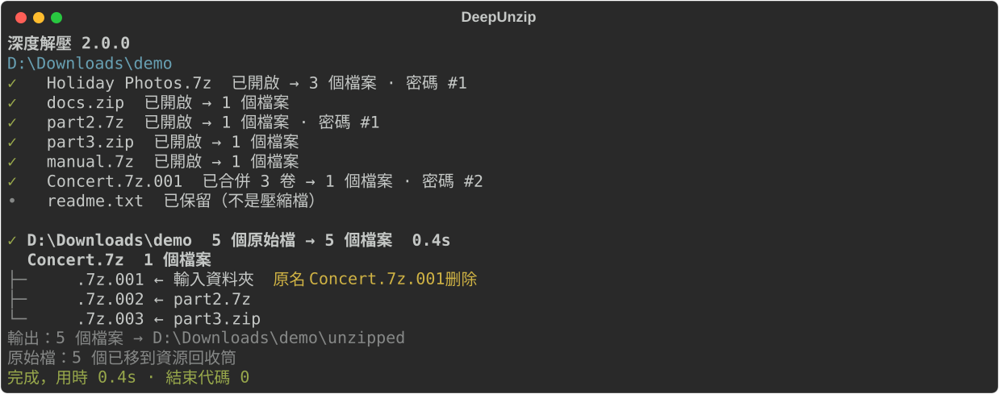

<p align="center">
  
</p>

<h1 align="center">深度解壓 DeepUnzip</h1>

<p align="center">
  <a href="https://github.com/rozx/DeepUnzip/releases/latest"></a>
  <a href="https://github.com/rozx/DeepUnzip/releases/latest"></a>
  <a href="https://github.com/rozx/DeepUnzip/releases"></a>
  <a href="https://github.com/rozx/DeepUnzip/releases/latest"></a>
  <a href="https://github.com/rozx/DeepUnzip/actions/workflows/ci.yml"></a>
  <a href="https://github.com/rozx/DeepUnzip/stargazers"></a>
  <a href="LICENSE"></a>
  
</p>

[简体中文](README.md) | [English](README.en.md) | **繁體中文** | [日本語](README.ja.md) | [한국어](README.ko.md)

深度解壓：一次解開巢狀、加密、分卷和偽裝的壓縮檔。

## 執行效果



上圖是一次實際執行的結果：資料夾裡有一個被改名的分卷，另外兩個分卷分別裝在兩個壓縮檔裡，其中一個還設了密碼。深度解壓先打開外層的壓縮檔，湊齊三個分卷，用密碼本裡的第二個密碼解開，最後列出每個分卷的來源。

## 解決什麼問題

壓縮檔用多了，總會遇到下面這些情況：

- 下載資料夾裡累積了幾十個壓縮檔，例如遊戲 Mod、素材包，或是 Google Takeout 拆成的一串照片匯出檔。把整個資料夾交給深度解壓，一次全部解開；解開的壓縮檔會移到資源回收筒，解不開的保持原樣。
- 同一個論壇、群組或作者分享的檔案，密碼來來去去就那幾個。把它們寫進 `passwords.txt`，程式會依序逐一嘗試，不必每次手動輸入；執行中新輸入的密碼也會自動記下來。
- 從論壇、Discord 或 Telegram 下載的 `.part1.rar` 到 `.part8.rar`，或是因為郵件附件大小限制而被拆成 `.zip`、`.z01`、`.z02` 的檔案。只要都在同一個輸入資料夾裡，就算分散在不同的子資料夾，程式也會自己湊齊再解壓縮。
- 壓縮檔裡還有壓縮檔，例如合輯裡的每個作品又各自打包。程式會一層一層解開，直到沒有壓縮檔為止。
- 為了通過郵件或聊天軟體的附件過濾，`.zip` 被改成 `.zip.txt` 這類名稱。程式依檔案內容而不是副檔名辨識壓縮檔。

手動處理這些情況，得一個個打開、試密碼、搬分卷，最後還要自己判斷哪些原始檔可以刪。深度解壓把這些合成一個指令，刪除原始檔前會確認它解出的內容都處理好了。

## 功能

- 依規則還原被改壞的檔名，規則寫在 `config/cloaked_file_rules.json`，可以自行新增。如果檔案最後沒能解開，原本的檔名會被改回來。
- 支援 `.7z.001`、`.part1.rar`、`.rar` + `.r00`、`.zip` + `.z01` 等分卷格式。分卷可以散落在不同資料夾，也可以藏在別的壓縮檔裡。
- 依序嘗試 `passwords.txt` 裡的密碼。執行中手動輸入的密碼會用於之後的壓縮檔，並在結束時儲存。
- 逐層解開巢狀的壓縮檔，直到沒有新東西可解。
- 原始檔只有在解出的內容全部處理成功後才會刪除，預設移到資源回收筒。解不開的東西會保留，並在最後寫明原因和位置。
- 提供 `--json` 輸出和明確的結束代碼，方便寫進腳本。
- 發布套件內附 Python 和 7-Zip 26.03，下載後直接執行。

## 快速開始

1. 在 [Releases](https://github.com/rozx/DeepUnzip/releases) 下載對應系統的發布套件（見下方「發布套件」）。
2. Windows：解開 `.zip`，把要處理的資料夾或壓縮檔拖到 `deepunzip.exe` 上。
3. macOS / Linux：解開 `.tar.gz`，在終端機執行：

   ```bash
   tar -xzf deepunzip-v2.0.0-macos-arm64.tar.gz
   ./deepunzip ~/Downloads/archives
   ```

解出的檔案在輸入資料夾裡的 `unzipped/` 下。

## 用法

```text
deepunzip [選項] <檔案或資料夾>...
```

傳入資料夾時會處理其中所有檔案；只傳入一個分卷時，同一資料夾裡同組的其餘分卷會自動帶上，包括被改過名的。輸出寫到輸入資料夾（或檔案所在資料夾）下的 `unzipped/`。

| 選項 | 作用 |
| --- | --- |
| `--permanent-delete`, `-pd` | 直接刪除已解開的原始檔，不移到資源回收筒 |
| `--json` | 輸出供程式讀取的 JSON 行，不詢問任何問題 |
| `--version`, `-v` | 顯示版本 |
| `--help` | 顯示說明 |

### 密碼

在 `passwords.txt` 裡每行寫一個密碼。程式會讀取兩個位置的密碼本並合併：

- 程式旁邊的 `passwords.txt`（從原始碼執行時是專案根目錄）；
- 輸入資料夾（或輸入檔案所在資料夾）裡的 `passwords.txt`。

空密碼一定最先嘗試。以 `#` 開頭的行是註解，以 `#` 開頭的密碼寫成 `\#abc`。檔案可以是 UTF-8、GBK、Big5 或 UTF-16 編碼。

所有密碼都不對時，程式會詢問：輸入密碼、略過這個壓縮檔，或略過之後所有的密碼詢問。輸入的密碼如果解開了檔案，會加到程式旁邊的 `passwords.txt`。輸出不會出現密碼本身，只會寫「密碼 #2」這樣的序號。

### 語言

輸出支援繁體中文、簡體中文、英文、日文和韓文，預設跟隨系統介面語言，其他語言的系統輸出英文。設定環境變數 `DEEPUNZIP_LANG` 可以指定語言，可選值為 `zh-TW`、`zh`、`en`、`ja`、`ko`。

### 結束代碼

| 結束代碼 | 意義 |
| --- | --- |
| `0` | 全部解開，或沒有需要處理的東西 |
| `1` | 執行完成，但有解不開的項目，對應的原始檔已保留 |
| `2` | 無法執行：找不到 7-Zip、給出的路徑都不存在，或程式出錯 |

### 在腳本裡使用

加上 `--json` 後，標準輸出每行是一個 JSON 物件，最後一行一定是 `summary`：

```json
{"event": "summary", "schema_version": 1, "status": "partial", "files": 12, "output_dirs": ["D:\\Downloads\\unzipped"], "sources": {"deleted": 3, "kept": 1}, "unresolved": [{"root": 1, "path": "locked.7z", "reason": "password"}], "exit": 1}
```

`--json` 模式下不會詢問密碼，也不會在結束時等待按 Enter。標準輸入不是終端機時（例如排程工作）同樣不會詢問。

## 運作原理

1. 掃描輸入資料夾，依規則還原被改壞的檔名。
2. 一輪一輪地處理。每輪把能打開的壓縮檔解開一層，解出來的檔案進入下一輪。
3. 外層都解開以後，開始組合分卷。程式先在第一卷所在的資料夾裡找同組的分卷，湊不齊再往外層資料夾擴大範圍，最遠到輸入資料夾。每種組合先用檔案大小和 7z 檔頭篩選，再交給 7-Zip 驗證。
4. 執行中輸入的新密碼會用於之後的壓縮檔，之前因密碼失敗的分卷組也會用它再試一次。
5. 某一輪沒有任何進展時結束。解出的檔案移到 `unzipped/`。從壓縮檔裡解出、但處理不了的東西（打不開的內層壓縮檔、湊不齊的分卷）也放到那裡；輸入資料夾裡原有的檔案留在原處。
6. 一個原始檔只有在它解出的所有內容都處理成功後才會被刪除。

執行途中被中斷時，下次執行會把搬走的分卷放回原處，並詢問是否還原上次的改名。

## 發布套件

| 平台 | 檔案 |
| --- | --- |
| Windows x64 | `deepunzip-v2.0.0-windows-x64.zip` |
| macOS Intel | `deepunzip-v2.0.0-macos-x64.tar.gz` |
| macOS Apple Silicon | `deepunzip-v2.0.0-macos-arm64.tar.gz` |
| Linux x64 | `deepunzip-v2.0.0-linux-x64.tar.gz` |
| Linux ARM64 | `deepunzip-v2.0.0-linux-arm64.tar.gz` |

每個套件包含程式、內附的 7-Zip 和授權檔案，Release 頁面另有 `SHA256SUMS`。Linux 版在 Ubuntu 24.04 上建置。程式沒有程式碼簽章，macOS 版也沒有經過公證。7-Zip 的來源和校驗值見 [7z/README.md](7z/README.md)。

這一版的變更見[發布說明](docs/releaseNotes/v2.0.0.md)。

## 常見問題

### 為什麼有些原始檔沒被刪除？

它解出的內容裡有東西沒處理成功，例如密碼不對或分卷不全。執行結束時的清單會寫明每一項的原因和位置。補上密碼或分卷後再執行一次即可。

### Windows 顯示「Windows 已保護您的電腦」

程式沒有程式碼簽章，第一次執行時可能出現這個提示。點「其他資訊」，再點「仍要執行」。

### macOS 顯示無法驗證開發者

程式沒有經過公證。在終端機執行 `xattr -d com.apple.quarantine ./deepunzip` 後再執行。

### 檔名被改成了規則沒涵蓋的樣子

在 `config/cloaked_file_rules.json` 裡加一條規則，格式見 [AGENTS.md](AGENTS.md) 的「Renaming/Uncloaking rules」一節。歡迎把新規則提交回來。

### 資料夾裡出現了 `temp.deepunzip-` 開頭的資料夾

這是上次執行中斷後留下的工作資料夾。下次執行時會提示它的位置，確認裡面沒有需要的檔案後就可以刪除。

## 開發

需要 Python 3.11+ 和 [Poetry](https://python-poetry.org/)。

```bash
git clone https://github.com/rozx/DeepUnzip.git
cd DeepUnzip
poetry install

poetry run deepunzip <檔案或資料夾>   # 從原始碼執行，也可以用 dz
poetry run pytest -q                   # 執行測試
poetry run build                       # 建置目前平台的獨立程式到 dist/
```

要在目標系統和架構上建置。架構、開發慣例和發布流程見 [AGENTS.md](AGENTS.md) 和 [CLAUDE.md](CLAUDE.md)。

修改終端機輸出後，用 `poetry run python -m scripts.generate_screenshots` 重新產生上面的截圖。

## 授權與致謝

深度解壓以 MIT 授權條款發布，見 [LICENSE](LICENSE)。解壓縮引擎是 [7-Zip](https://www.7-zip.org/)，隨每個發布套件附上，適用它自己的授權條款（GNU LGPL 和 unRAR 限制）。

作者：[Rozx](https://github.com/rozx)
